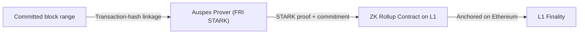

# Zero-Knowledge Proofs & Auspex

> **The Truth Layer for Verifiable Information.** JMDT uses Zero-Knowledge Proofs as the cryptographic backbone for privacy-preserving identity, private transactions, and verifiable computation — without exposing any underlying data.

Zero-Knowledge Proofs (ZKPs) allow one party to prove knowledge of certain information without revealing the information itself. In JMDT, ZKPs ensure **privacy and security while maintaining verifiability** across financial, identity, and enterprise applications.

---

## STARK Proofs via Auspex

JMDT's proof system is built on **zk-STARKs** (Scalable Transparent Arguments of Knowledge), generated by **Auspex**, JMDT's in-house STARK prover:

- Offer **enhanced scalability and transparency** with **no trusted setup** required
- Use hash-based cryptography — **quantum-resistant** and highly secure
- Particularly useful for large-scale computations in a trustless, decentralised manner
- Used for: transaction-level validation, DID authentication, L2 state checks, and the L2 → L1 anchoring pipeline (full state-transition proving being completed); with the planned L3, DAG state commitments

---

## Auspex — JMDT's In-House STARK Prover

JMDT's proofs are generated by **Auspex**, a STARK prover built in-house for the JMDT pipeline. Auspex is a **FRI-based** proof system operating over the **Goldilocks field** with **keccak-256** hashing — fully hash-based, with **no trusted setup** and no elliptic-curve assumptions.

### Why an in-house prover?

- **Purpose-built** — Auspex proves exactly what the rollup pipeline needs: linking the transactions of a block range into a single verifiable commitment
- **Transparent** — FRI-based STARKs require no trusted setup or ceremony
- **Quantum-aware** — hash-based cryptography throughout, with no elliptic-curve assumptions in the proof system
- **Evolves with the protocol** — the prover is developed, audited, and versioned alongside the chain itself

### Workflow

---

## Circuit Types

### 1. Transaction Validation Circuits (L2)

- Written in Rust as deterministic logic
- Validate balances, DID authentication, signature correctness, and state transitions within L2
- Output a **commitment hash** consumed by the zk-rollup aggregator

### 2. Aggregation & State Transition Circuits (L2 → L1)

- Aggregate multiple rollup blocks (and, with the planned L3, DAG state transitions)
- Execute recursive verification logic or Merkle root reconciliation
- Generate a succinct **STARK proof** using Auspex for Ethereum submission — full state-transition proving is being completed

---

## ZK in Practice: Privacy-Preserving Queries

JMDT introduces a **DID-based querying mechanism** that enables privacy-preserving data access:

1. Users and enterprises can query blockchain data **without exposing sensitive details**
2. **Zero-Knowledge cryptography** prevents unauthorised access while allowing verifiable computations
3. **Federated and differential privacy techniques** ensure compliance with GDPR, HIPAA, and data sovereignty regulations
4. On-device ZK computation ensures personal data is verified without ever being shared

---

## Security Properties

| Property | Guarantee |
|---|---|
| **Completeness** | An honest prover can always convince the verifier |
| **Soundness** | A malicious prover cannot forge a valid proof |
| **Zero-Knowledge** | The verifier learns nothing beyond the truth of the statement |
| **Quantum Resistance** | zk-STARK proofs use hash-based cryptography — no elliptic curve assumptions |
| **Reproducibility** | Auspex ensures deterministic proof generation across all nodes |

---

## L1 Finality — Ethereum Commitment

Once a block is committed on JMDT L2, the Sequencer periodically anchors it to Ethereum for global finality:

1. The Sequencer Orchestrator selects a committed block
2. It generates an **Auspex STARK proof** of the block's commitment
3. It calls **`commitRollup()`** on the **ZKRollup smart contract** deployed on Ethereum

The `ZKRollup` contract enforces two invariants before accepting a commitment:

- **Nonce ordering** — rollup commitments must be submitted in strict sequence; a commitment with an out-of-order nonce is rejected
- **Double-commit protection** — the same block commitment cannot be submitted to L1 more than once

Once `commitRollup()` succeeds, the block inherits Ethereum's censorship-resistance and finality guarantees.

See [Transaction & Block Lifecycle →](/docs/transaction-lifecycle) for how this fits into the full flow.

---

## Integration Points

- **AVC Consensus** — Buddy committees validate and finalise blocks; finalised blocks feed the ZK rollup anchoring pipeline. See [AVC Consensus →](/docs/bft)
- **DID Engine** — ZKPs authenticate user identity without exposing PII. See [Decentralised Identity →](/docs/did)
- **Sequencer & MemPool** — Orders and batches transactions; triggers zkVM proof generation. See [Sequencer →](/docs/sequencer)
- **L1 Commitment** — Block commitments submitted to the JMDT `ZKRollup` contract via `commitRollup()`; full state-transition proving is being completed
